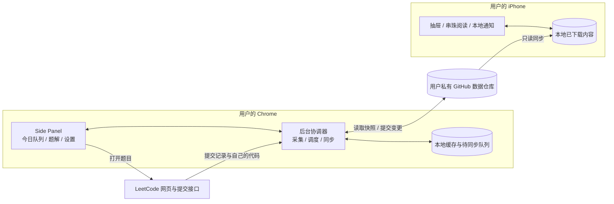
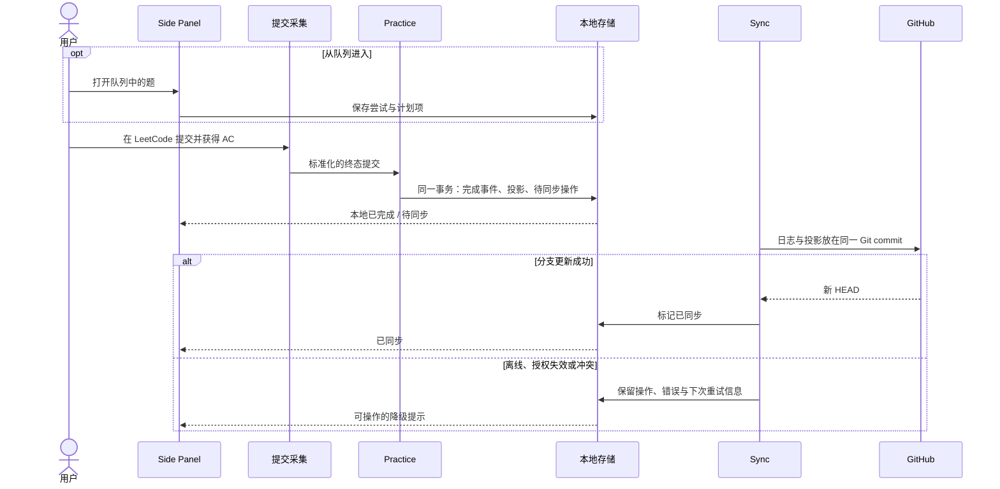
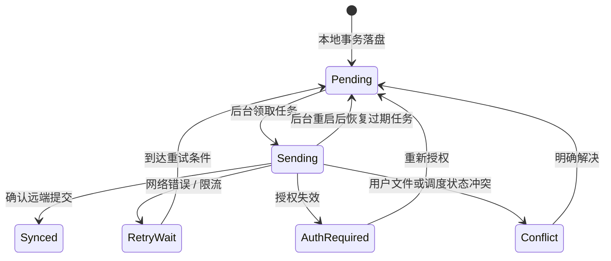

# Leet Jounry 架构与行为规格

日期：2026-11-16  
修订：2026-11-17，补齐自由刷题、离线叠加、规则快照、每日额度、跨日归属与提醒边界。  
状态：当前主规格，供用户审阅；不代表业务实现已开始。  
UI 参考：[HTML 设计稿](design/leet-jounry-ui.html)

## 1. 目的与决定的优先级

Chrome 是做题、复习和写入的场所；iOS 是阅读、查看进度和接收提醒的工具。用户自己的私有 GitHub 仓库保存跨设备共享的个人数据，产品不提供自建数据后端。

本规格结合以下材料，按较新的明确决定覆盖较旧方案：

1. 当前对话最后确认的行为与 UI。
2. 2026-11-16 Claude Code 历史会话 `1fc87caf-4047-49b9-9007-32bc727b6d47` 的用户决定及后续修订。
3. [历史产品设计](superpowers/specs/2026-11-16-chrome-extension-github-as-source-design.md)，仅用于背景和决策溯源，不与本规格并列作为行为要求。
4. 提供的 16 份软件工程课件，以及现有 Python / SwiftUI 代码。

历史会话中的研究建议不自动视为用户决定。本规格不执行旧对话中的删库、迁移、提交或发布指令。

**本轮覆盖旧方案的关键点：**

- 产品名为 **Leet Jounry**。
- 练习模式为「只复习 / 只做新题 / 复习 + 新题」。
- 复习方式只保留「轮次复习 / 自动间隔复习」，在 Chrome 设置中选择。
- AC 自动记录本次完成；不要求评分，不用提示展开、耗时、错误提交次数推断掌握程度。
- 旧的 Again / Hard / Good / Easy 必填流程、默认 Good 和行为推断评分均退出首版。
- 因为不再收集记忆评分，首版不把 FSRS 当作现行调度算法；旧 FSRS 代码和基准仅作为历史资产保留至迁移确认。
- 题单由程序直接读取 GitHub 上的 Markdown 表格；不做导入向导、应用内题单编辑器或内置题单商店。
- 公司 / 标签 / 题单可交叉筛选，各自有可搜索的多选页。
- 分享保留三种卡：X 天阶段成绩、单题题解、每日做题清单。
- 两端和分享卡支持浅色、深色、跟随系统。

## 2. 已确定的范围

| 项目 | 规格 |
|---|---|
| Chrome | 公开免费、MV3 Side Panel；不向 LeetCode 页面插入产品 UI，不自建代码编辑器或判题器 |
| iOS | 沿用现有 SwiftUI app；纯读、离线阅读、本地通知；不评分、不写共享业务数据、不运行调度器 |
| GitHub | 用户自己的私有纯数据仓库；与产品代码分离；两端 Device Flow 授权 |
| 内容 | `prompt.md`、`pseudocode.md`、`review.md`、用户的代码版本；不复制或分发 LeetCode 原题面 |
| 阅读 | 题意 → 伪代码 → 题解 → 我的代码；点到下一层才渲染下一张卡；不重复设置展开门槛 |
| 文件叫法 | UI 叫「题解」，文件仍是 `review.md`；不增造 `solution.md` |
| 首页 | iOS 阅读页上的 79% 宽抽屉；题单 / 标签 / 公司 / 时间横向切换；选分类后收起 |
| 外观 | flomo 参考的字体、留白、卡片层级与热力图；整页 HTML 是展示稿，不是待发布产品 |
| AI | 不做 AI 交互监控、掌握度评估或自动判分；旧的按需草稿设想不进入本次实现主链路 |
| 其他退出项 | Notion、派生整包 `content.json`、日常 Mac 定时采集、elements 自动答案、独立「一句话本质」层 |
| 商业化 | 先免费；未来 iOS 可考虑买断，不在首版实现收费体系；不做订阅或 license 后端 |
| 通用化 | 仅保留 `domain: "leetcode"`；不构建通用卡片平台或插件框架 |
| Widget | 本轮不做 |

离线可用指已经下载的内容可阅读，以及本地已确认的练习事件可排队同步。首次从未下载的正文无法凭空离线获取；全库离线缓存可以作为明确的下载操作，不伪装成懒加载已经覆盖全库。

## 3. 采用什么架构

采用 **共享仓库架构 + 客户端内部薄分层**。Chrome 与 iOS 不直接通信，通过仓库交换共享数据；本地缓存支撑断网使用，扩展的本地待同步队列保护未提交事件。

| 课件中的设计 | 本项目如何使用 | 不采用的扩大方式 |
|---|---|---|
| Repository architecture，Lecture 5-3，第 5–7 页 | 用户 GitHub 仓库是共享数据中心 | 不另建自己的业务数据库 |
| Layered architecture，Lecture 5-3，第 2–4 页 | 表现、用例、领域规则、外部适配分开 | 不为每个小函数创造一层接口 |
| MVC，Lecture 5-2，第 4–6 页 | 使用表现与业务分离的原则；React 状态模型、SwiftUI 可观察模型承载界面状态 | 不把 SwiftUI 硬改成传统 MVC，也不做巨型 Controller |
| Architectural views，Lecture 5-1，第 8 页 | 同时说明部署、模块、数据与运行流程 | 不只交付一个文件夹树 |
| Sequence / state models，Lecture 6-1、6-2 | 明确 AC、离线、重试、冲突的事件顺序 | 不上消息中间件或分布式事件总线 |
| Pipe and filter，Lecture 5-3，第 11–13 页 | 一次性数据迁移：读取 → 转换 → 校验 → 写目标目录 | 不用旧七步批处理统领实时交互 |
| Incremental development，Lecture 2-1；simple design，Lecture 3-1 | 先验证授权与写入闭环，再接阅读端 | 不一次重写全部旧代码后才验收 |

技术建议：Chrome 使用 TypeScript + React + MV3；iOS 保持 SwiftUI。两种语言共享 JSON 格式、语义和测试样例，不共享一个跨语言运行时。具体构建工具与精确依赖版本在实现准备时锁定。



图中的“本地缓存”是仓库数据的副本；“待同步队列”是尚未进入共享仓库的耐久记录。扩展未推送前，手机看不到新进度，UI 必须明说，不能把本地完成等同于两端已同步。

## 4. 模块与职责

模块通过少量明确的 interface 交互。外部服务的差异留在 adapter 内，UI 不拼接 GitHub 请求或修改调度状态。

| 模块 | 负责什么 | 对调用方提供什么 |
|---|---|---|
| AccountConnection | GitHub Device Flow、令牌刷新、账号与仓库绑定；检测 LC 登录是否可用 | 当前连接状态、授权请求；不把 token 交给页面脚本 |
| LeetCodeCapture | 获取近期提交、补拉终态与 AC 代码、游标续传、提交 ID 去重 | 标准化 `SubmissionRecord` 与采集覆盖范围 |
| Library | 题目索引、四层内容、公司标签、旧 LeetHub 目录识别、Markdown 题单读取 | `getIndex`、`getContent(problemId)`、`getLists` |
| Practice | 根据练习模式、复习方式、范围和上限生成今日队列；接收一次完成事件 | 今日计划、一次完成后的新状态 |
| Sync | 读取 Git 快照、增量缓存、耐久写队列、批量原子提交、冲突处理 | `refresh`、`flush`、待同步 / 失败 / 冲突状态 |
| Statistics | 复习覆盖、今日完成、提交清单、X 天成绩；统一时区和去重 | 带来源、窗口、完整性信息的统计模型 |
| Share | 用统计模型或用户题解生成三种图 | 预览、下载 PNG；不自行重新计算另一套数字 |
| Appearance | 浅色 / 深色 / 系统主题，统一 token | 解析后的主题；本地偏好不写业务仓库 |
| iOS ReadModel | 同步后的索引、阅读层、分类与本地通知 | UI 状态；没有写仓库或推进复习的 interface |

依赖方向：**UI → 用例协调 → 纯规则与存储 interface；外部 adapter 实现存储和传输 interface。** GitHub token、HTTP 状态码、重试和冲突等复杂性集中在连接与同步模块。

Chrome 的 Side Panel 和后台是两个执行环境，不得共享一份只存在内存里的状态。后台是共享业务写入的唯一协调者；Side Panel 用带版本的消息发送命令、订阅快照。

## 5. 两个相互独立的设置维度

### 5.1 练习模式：今天安排哪些题

| 模式 | 复习队列 | 新题队列 |
|---|---|---|
| 只复习，默认 | 按所选复习方式安排 | 隐藏，不要求主线题单 |
| 只做新题 | 不展示；原有复习记录和到期状态仍保留 | 从一个主线题单按顺序取尚未做过的题 |
| 复习 + 新题 | 优先完成当天安排的复习 | 当天安排的复习完成后开放新题 |

“复习优先”指当天上限内的计划，不要求先清空整个历史逾期库才能接触新题。建议初始每日复习上限 20 道，新题目标 0；切换到含新题模式时由用户设定数量和主线。20 道是产品初值，不是科学上唯一合适的数值。

这三种模式只控制系统推荐什么，不限制用户自由刷题。用户自行打开 LeetCode 做题，同样采集提交、归档代码；符合第 6 节条件的完成可自动抵扣复习，不要求从扩展入口打开。即使选择“只做新题”，自由重做当前待复习题仍按同一规则记复习完成。

### 5.2 复习方式：完成后怎么安排

**自动间隔复习**：每道题独立维护阶段和 `dueAt`。建议默认阶段为完成后间隔 1、3、7、14、30、60 天；最后一档继续以 60 天循环。用户可在 Chrome 调整。上述数字为实现默认建议，不属于已确认的医学或记忆效果结论。

- 首次 AC 后入库，初始化阶段，下次为 1 天后。
- 每次有效的复习完成，将阶段推进一级，从实际完成的当地日期计算下次日期。
- 错过几天不重置阶段，也不补造完成事件。队列优先呈现逾期最久的题。
- 一天内同题的连续重交、重复通知，不额外推进阶段。
- 到期日期以配置时区的日历日计算，不能用固定 24 小时毫秒数代替，避免夏令时跨日错误。

**轮次复习**：建立一份固定题目集合的轮次计划，把选定范围过完一遍，再进入下一轮。

- 开始一轮时冻结题目 ID 与顺序，默认只纳入已做过、已入库的题。
- 当前轮次每题最多记一次完成。每日仍受复习上限限制。
- 同轮未完成题不因切换日期消失；优先安排未完成的题。
- 本轮完成后记录轮次结束；下一轮最早在下一个当地日开始，避免同一天无限循环。
- 新入库题、题单增删、标签变化不偷偷改变正在进行的一轮；下一轮采用新集合。
- 修改范围时，Chrome 展示“下轮生效 / 现在重建本轮”的明确操作。重建保留完成历史，创建新的计划 ID。
- 本轮题目已删除或无法读取时，显示阻塞项，并允许明确移出本轮；不默默记为完成。

两种方式都不采集必填记忆评分，不承诺自动识别真正掌握程度。切换复习方式是 Chrome 的显式操作：保留全部历史完成事件；切入轮次时创建新轮次；切回间隔时按有效完成次数和最后完成日期生成新的阶段与到期预览。用户应用预览后，记录 `PolicyActivated` 与 `ScheduleRebased`，后者保存本次应用的题目阶段、到期日期或轮次引用；重放时使用这些已确认的转换结果，不使用现行设置重新猜一次。

只调整间隔参数时，默认从此后的有效完成开始使用新规则，已经安排的 `dueAt` 保持不变。若用户明确应用“重排当前安排”，则另记 `ScheduleRebased`，历史完成事实不变。规则版本和完整参数的保存见第 8 节。

## 6. 什么才算一次完成

正常路径是：**在 LeetCode 做题 → 新 AC → 本地自动记完成 → 后台同步**。既支持从今日队列进入，也支持自由打开题目。不强制评分，也不自动跳走；用户可以停留阅读或修改题解。

### 6.1 提交归档与完成分类

所有绑定账号的终态提交先按 `submissionId` 去重归档。用于判定的时间为 LeetCode 的提交时间，不使用抓取到它的时间冒充完成时间。无法确认账号、题号、先前已做状态或适用的历史安排时，先保存提交和待分类状态，不臆断首次做出，也不暂记一次完成再静默取消。

| 情况 | 产生什么事实 | 是否推进复习 |
|---|---|---|
| 接入后的首次 AC，无论是否来自新题队列 | `NewProblemSolved`；初始化题库与阶段 0、首次复习日期 | 加入后续安排，不增加“已复习题数” |
| 自动间隔方式下，已解题的到期日不晚于该次 AC 的当地日，或该题处于 `waitingForFirstReview` | `ReviewCompleted`，`source` 为队列或自由练习 | 自动抵扣、推进一次；不受当前筛选或入口限制 |
| 轮次方式下，该题属于当前生效轮次，且本轮尚未完成 | `ReviewCompleted` 并关联轮次项 | 自动抵扣本轮；不要求它已经出现在当天推荐列表 |
| 已解题尚未到期，或本轮该题已完成后的额外 AC | 提交活动与代码版本 | 不再次推进间隔或轮次 |
| 接入前的历史 AC 回填 | 提交活动、已做状态与导入来源 | 不生成今天的完成，不补造过去的复习 |
| Wrong Answer 等非 AC 终态 | 提交活动 | 不产生完成或失败评分 |

“接入后”以耐久保存的 `captureEpochStartedAt` 和绑定 LC 账号为界。接入后发生、因离线而稍后抓到的提交仍按其实际发生时间分类；接入前的回填单独标记。分类依据包括当时的规则版本与安排，不能拿今天的状态判断过去是否到期。同一次抓取批次按提交时间和提交 ID 的稳定顺序处理；缺少覆盖信息的部分保持待分类。

首次 AC 在间隔方式下设置阶段 0，下次为 1 天后；第一次有效复习后进入阶段 1，下次为 3 天后。在轮次方式下，首次 AC 先入库、保留阶段 0 的来源，不塞进已经冻结的当前轮次；下一轮或切回间隔时按明确的转换规则纳入。

### 6.2 去重、计划抵扣与自由练习

- `PracticeAttempt` 只用于从队列进入时关联账号、题目、原计划与开始时间；自由练习允许 `attemptId = null`，不把点击入口作为完成的必要条件。
- 同一提交 ID 全局只处理一次；同题在一个当地日内最多推进一次复习阶段或轮次，即使换筛选、重建计划或收到重复通知也不重复计数。
- 对队列尝试，AC 须晚于尝试开始。自由练习按上表与提交发生时的状态匹配，不套用一个不存在的开始时间。
- 若同题在本轮已完成，重建本轮时不能靠新计划 ID 绕过同日去重。历史 AC、实时首次做出和有效复习严格区分。
- `NewProblemSolved` 抵扣相应新题计划项；`ReviewCompleted` 抵扣适用的复习或轮次项。没有匹配每日项时仍可是真实的自由复习，其额度和统计按第 7 节计算，不为了匹配而强塞一个额外推荐项。
- 错误提交、浏览提示、长时间停留、切标签页均不推断掌握程度。

### 6.3 题解与撤销

题解可以稍后修改，自动记完成不依赖必须先写题解。AC 后直接显示 flomo 式“题解”卡片，正文完整呈现，不使用摘要、省略号、固定高度裁切或“展开全文”；长正文随页面自然滚动，不另放绿色完成卡、下次复习说明或判分解释。分享 / 编辑 / 复制以小号按钮放卡片顶端。

编辑可保存或取消，保存更新对应题目的 `review.md`；生产版本先保存为耐久草稿再加入同步队列。离开不静默丢失未保存内容，分享和复制不改变调度。

撤销误记时追加引用原事件 ID 的 `CompletionVoided`，不删除历史。按原事件种类重建题目阶段、轮次完成集合、每日额度与计划覆盖关系；重复撤销同一事件没有额外效果。这是记录修正，不恢复评分流程。



## 7. 复习范围与今日队列

公司、标签、题单为集合；同组取 OR，不同组与时间条件取 AND。未选择的维度表示不限。筛选只改变当前计划候选集，不改变范围外题目的到期日期。

公司 / 标签 / 题单的主页只显示已选项。点“选择”进入面板内的搜索多选页；已选置顶，列表自身滚动。点完成才提交；返回或 Esc 放弃草稿；其他维度与时间不变。超过两个已选项折叠为 `+N`。

今日复习 list 固定可视高度、内部滚动；标题、完成统计、开始 / 下一题按钮和底部 tab 不随每道题滚走。键盘可聚焦、滚动和打开题目，不能只靠鼠标滚轮。

计划生成时保存本地日期、时区、设置版本、候选集快照与题目顺序。前后台重启不重复抽题；当天切设置只重建未完成部分，完成历史保留。轮次方式修改范围，必须遵循第 5.2 节的“下轮生效 / 明确重建”，不能套用间隔方式的即时筛选去改动冻结集合。

计划也是跨端共享数据：每日计划保存到 `plans/daily/YYYY-MM-DD.json`，轮次快照保存到 `plans/rounds/<planId>.json`。当前文件包含 `schemaVersion`、`planId`、`revision` 与对应 `plans/versions/<planId>/<revision>.json` 引用，并保留供 UI 使用的当前投影；不可变版本保存时区、创建时刻、设置快照、题目 ID 顺序；每日版本另有上限、题目种类与轮次引用，轮次版本另有轮号、范围快照和起止状态。历史事件引用具体计划版本与稳定题目项 ID；更新当前文件时不能覆盖旧版本快照。完成集合是事件投影，不是另一套完成事实。

扩展在生成或变更计划时排队写入；每次完成，把完成日志、题目调度、每日计划以及适用的轮次投影放在同一 Git commit。iOS 读取这些已提交的计划，不自行重建每日成员或轮次集合。当天扩展尚未生成计划时显示“今日计划尚未同步”，仍可查看库和读取到期日期；不能拿旧计划改个日期冒充今天。

### 7.1 每日额度与重建

每日额度只限制系统新增推荐，不限制用户继续自由做题。按事件的 `activityDay` 和种类分别计算：

- `reviewUsed(D)`：D 日有效、未撤销的 `ReviewCompleted` 去重题数，包含自由复习和跨午夜完成。
- `newUsed(D)`：D 日 `NewProblemSolved` 去重题数，包含自由首次做出，不与复习共用额度。
- `reviewRemaining = max(0, reviewLimit - reviewUsed(D))`。
- `newRemaining = max(0, newGoal - newUsed(D))`。

首次生成、修改范围、切换模式、重建计划和重启后续排，均使用上述剩余额度。已保留的未完成推荐也占剩余名额：新补入数量不得超过“剩余额度减已保留项数”。例如上限 20、已复习 5 题，换标签后最多保留或安排 15 道未完成题，不能再补 20 道。每次自由完成后也重算剩余额度；需要收缩推荐时优先移出尚未开始的队尾项，不记为完成或失败。已开始的练习可以继续，真实完成仍照常接收。

用户调低上限至已完成量以下时不撤销真实完成，只停止新增推荐。自由刷题可以让真实完成量超过目标；界面可显示“完成 25 题 · 目标 20”，不能拒收事件或把完成量截成 20。今日计划进度仍按具体计划项计算，额外完成另列，不把“真实完成量”和“计划项完成比例”混为同一数字。

### 7.2 跨午夜、时区与延迟采集

完成事件保存两个独立概念：`activityDay` 是提交发生的当地日期；`originPlanId` 指用户原本进入的计划，可以为空。`creditedPlanItems[]` 保存实际抵扣的计划项引用，不要求所有项的计划日期与活动日期相同。

例如 11 月 16 日 23:55 从昨日计划打开题目，17 日 00:05 AC：

- 复习活动、热力图、每日清单和额度均计入 **17 日**；下次日期从 17 日计算。
- 16 日的原计划项可标记“已于次日完成”，但不把这次活动改记为 16 日。
- 如果 17 日计划已经包含同题，其重复项标记“由该完成事件覆盖”；仍只有一个完成事件、一次阶段推进和一次 17 日额度消耗。
- 如果 17 日尚未生成计划，生成时先计入该事件，再排剩余额度，不再安排该题。

完成时间使用提交源时间；`recordedAt` 只表示本地记录时间。事件保存发生时生效的 IANA 时区、`activityDay` 与 UTC 时间戳，延迟同步后不重分日期。时区变更作为设置事件保存，在当前计划日结束后生效，历史事件和已确认计划不追溯改日。

### 7.3 手机读取与本地提醒

iOS 可根据已缓存的 `dueAt` 和当前未完成轮次安排本地提醒；读取日期并安排通知不等于运行复习调度器。每次成功同步、app 回到前台或获得系统允许的后台执行机会时，取消已过时请求，按最新缓存重排接下来 7 天、每天最多一条提醒。

通知默认使用“有复习安排，打开查看最新进度”等一般文案。没有新鲜快照时，不在通知中断言“今天准确剩余 N 题”；app 内展示数据截至时间。没有当日计划时，提醒只能代表缓存中的到期情况或未完成轮次，不能冒充已经生成的今日队列。

Chrome 未运行时不能保证生成或提交新计划；iOS 没有获得执行机会时不能保证刷新 GitHub。系统可以投递已经安排好的本地通知，但这不表示已抓取最新进度。不提供自建 APNs 推送后端，也不承诺两端实时提醒。[Apple 本地通知说明](https://developer.apple.com/library/archive/documentation/NetworkingInternet/Conceptual/RemoteNotificationsPG/SchedulingandHandlingLocalNotifications.html)

### 7.4 没有调度历史的旧题

**没有调度历史的已解旧题**进入 `waitingForFirstReview` 池，`dueAt = null`，不伪造上次完成日期，也不一次标记整个题库已逾期。默认间隔模式先排已有到期题，再从该池按最近实际 AC 时间降序、题号升序补足每日上限；只对被排入当天计划的题建立当天起始安排。首次有效复习才产生 `ReviewCompleted`，其后按阶段 1 的间隔安排。其余题保持“待开始”，不累计未发生的逾期。轮次模式可以将这些已解旧题纳入首轮快照。

待开始池的每日补入规则是本规格补足的技术默认值，用户可以通过复习范围选择先开始哪些题；它不改变既有题库或生成虚构的复习历史。

新题判定使用完整的已做题集合。仓库暂时没拉到某题的 `meta.json` 不等于用户没做过；LC 或仓库同步不完整时标注未知，不向用户保证“这是新题”。

## 8. 仓库文件与数据所有权

```text
lc-data/
  journey.json                           当前配置、规则引用、账号、接入时间和活跃写端
  policies/
    <policyVersion>.json                 不可变的完整调度规则快照
  problems/                              只放题目内容与该题的当前元数据
    0104-maximum-depth-of-binary-tree/
      meta.json                          题号、标题、难度、标签、公司与当前调度投影
      prompt.md                          自己复述的题意
      pseudocode.md                      思路、伪代码、复杂度
      review.md                          自己的题解，支持 ==高亮==
      solution_<submissionId>.py          自己的 AC 代码
  lists/                                 题单，不放进某道题的目录
    autumn.md                            一个题单，一张 Markdown 表
  plans/                                 跨题目的练习计划
    daily/2026-11-16.json                 当前每日计划及版本引用
    rounds/<planId>.json                  当前轮次及版本引用
    versions/<planId>/<revision>.json     不可变的计划版本快照
  reviews/                               跨题目的复习事件
    2026-11.jsonl                         只追加的练习、撤销与计划变更事件
  activity/                              LeetCode 提交活动及采集状态
    submissions/2026-11.jsonl             按提交 ID 去重的终态提交元数据
    coverage.json                        采集覆盖范围、游标、更新时间与缺失情况
```

题目内容与跨题目的运行记录分目录保存：`problems/` 只容纳每题的内容与当前元数据；`lists/`、`plans/`、`reviews/`、`activity/` 均为仓库根目录的同级目录，不嵌入某道题下面。`reviews/` 存复习事件，`problems/<id-slug>/review.md` 存题解正文，两者含义不同。`journey.json` 明确 `contentRoot: "problems"`。

题目身份为 `domain + frontendProblemId`，目录名用于定位，不把目录重命名视为新题。题号最少补到四位，超过四位不截断。

`meta.json` 最小字段：`schemaVersion`、`domain`、`problemId`、`slug`、`title`、`difficulty`、`techniques[]`、`companies[]`、`firstAcceptedAt`、`lastAcceptedAt`、`schedule`。公司标签带来源与可用性；没有公司数据时是未知，不表示“没有公司考这题”。

`schedule` 是 Practice 从完成历史产生的读投影，包括当前方式、阶段或轮次引用、下次日期、最后完成时刻、投影版本。iOS 读取投影，不重跑调度。日志才是历史事实，投影损坏可由扩展重建。

完成事件必须区分 `NewProblemSolved` 和 `ReviewCompleted`；撤销事件引用原事件 ID。完成事件至少保存：`eventId`、`type`、`occurredAt`、`recordedAt`、`problemId`、`submissionId`、`source`（`queue` / `free`）、可空的 `attemptId` 与 `originPlanId`、`creditedPlanItems[]`、`policyVersion`、事件时区、`activityDay` 和 `writerId`。提交 ID 按绑定账号隔离；事件 ID 与本地操作 ID 在重试时保持不变。

### 8.1 完整规则快照与可重建性

`policies/<policyVersion>.json` 保存不可变的完整参数：规则格式版本、算法实现版本、方式、间隔数组、首阶段和末阶段行为、轮次生效规则、同日去重口径、分日与时区生效约定。每次参数变化创建新版本，旧文件不覆盖；`journey.json` 仅指向当前版本，不能充当旧参数的唯一存储。

`PolicyActivated` 保存前后规则引用、生效时间与设置版本。策略切换或明确重排保存 `ScheduleRebased`，包含各受影响题目的阶段、到期日或轮次引用及重排原因。每日额度、范围、顺序和时区等当时的设置快照保存在对应计划版本中；历史完成事件关联的计划版本不得只剩一个已被覆盖的当前文件。

重建使用历史事件、其引用的不可变规则和计划版本，以及已确认的重排结果。仅有 `policyVersion` 字符串而找不到参数文件时，标为无法验证该段历史，保留上次有效投影，不用当前参数静默替代。撤销可以重建后续受影响状态；其余规则编辑不回写过去的完成事实。

题解、题意和伪代码属于用户。同步按基础 SHA 检测并发修改，不以“最后写入获胜”覆盖用户内容。代码版本按提交 ID 归档，不因去重算法删掉历史版本。

### 8.2 Markdown 题单

```markdown
# 秋招冲刺

| 题号 | 题目 | 难度 | 已做 | 复习次数 | 下次复习 |
| --- | --- | --- | --- | --- | --- |
| 1 | Two Sum | Easy | ✓ | 3 | 2026-11-20 |
| 104 | Maximum Depth of Binary Tree | Easy | ✓ | 1 | 2026-11-19 |
```

- 题号与行顺序是题单成员和顺序的权威输入；允许用户只写题号。
- 右侧进度列可由扩展更新，读取时仍以题目元数据与事件为准，不能相信可能过时的表格数字。
- 保留用户的题单正文及自定义列；遇到并发修改必须合并或报告冲突。
- 题单按文件路径稳定识别；同一题号重复行按首次出现排序并提示。
- 文件错误只隔离该题单，保留上次有效版本并显示错误；不能让其他题解或已完成记录一起消失。
- 不抓取表格中的任意远程 URL，不执行 Markdown HTML、脚本或命令。

新建数据仓库只写 `problems/<零填充题号>-<slug>/`。读取仍兼容旧 `Problems/<number>_<slug>` 和 LeetHub 根目录格式；适配器按题号识别题目，不把 `lists/`、`plans/` 等目录当成题目。相同题号出现在多种布局时优先使用配置的 `contentRoot`，其他位置有不同内容则提示冲突，不自动拼接覆盖。LeetHub 原题 README 不进入阅读或分享链；没有调度元数据的旧题显示“未建立复习记录”，不伪造历史。

## 9. GitHub 读取、冷启动与缓存

1. 固定仓库、分支，读取 HEAD；获取该提交对应的 tree。
2. 从 tree 取得路径和 blob SHA，与本地已验证缓存比较。
3. 先加载配置、题目 `meta.json` 和题单；正文与代码按用户打开逐题加载。
4. 同一轮读取始终钉在同一个 commit，避免题单、日期与正文来自不同版本。
5. 当前远端快照加载成功后，叠加未确认的本地操作，再原子发布界面状态；未变正文继续使用本地副本。不得用远端旧投影替换待同步的本地完成或题解。
6. tree 被截断时逐子树遍历；截断不是有效的完整索引，不能据此删除本地题目。
7. 错误 JSON、未知 schema、缺失权限、真实空库各有不同状态；不能统一返回空数组。

**Trees API 不会返回标题、难度、due 的内容。** 首次还需读取各题元数据。默认采用可恢复的受限并发（建议 4）逐批读取；后续只读 SHA 变化的元数据。可在验证后使用 GitHub GraphQL 批量 Blob 查询降低冷启动请求数，但不为此恢复 `content.json` 或引入必需生成的全库索引。

414 或 2000 道题的第一次启动仍有实际网络成本。显示进度与数据完整性；不能把尚未加载的题统计为 0。具体启动时间在真实私有仓库上测量，不在规格里承诺未经测量的秒数。[Git Trees 文档](https://docs.github.com/en/rest/git/trees)

缓存键包含仓库身份与 blob SHA。切换仓库不能混用上个用户的缓存。iOS 缓存文件采取原子替换；服务端已同步、手机未刷新时仍显示自己的快照更新时间。

## 10. 写队列、冲突与恢复

后台使用事务型本地存储保存缓存、尝试、完成事件、投影和 outbox。建议 Chrome 以 IndexedDB 为主体，`chrome.storage.local` 保存少量界面偏好与连接信息。选择依据是完成与排队需要同一事务，而不是把单条队列仅放在内存中。

### 10.1 远端快照与本地待同步叠加

Chrome 的可见状态定义为：`materialize(最后验证的远端快照, 尚未被远端确认的本地操作)`。本地操作带稳定 ID 和耐久顺序；事件、题解草稿、计划更新和 outbox 在本地事务中一起保存。服务器快照更新只替换基底，不清除尚未确认的操作。

- 离线完成一题后，即使先拉到了远端旧状态，题目仍显示本地已完成、待同步；不退回待做。
- 远端已包含相同事件或操作时，叠加按 ID 去重。应用新基底和确认对应操作在同一本地事务中完成，不能先去掉本地操作、后补远端数据而出现闪回。
- 只有确认该操作已在远端出现后，才从待同步集合移出；网络失败、授权失效和刷新成功本身都不是确认。
- 远端同一用户文件被另外修改时保留本地草稿并进入冲突，不把它当作可以重新覆盖的旧缓存。
- iOS 没有业务 outbox，只显示最后成功同步的远端快照；不能把 Chrome 本地待同步状态宣传为手机已收到。

### 10.2 队列恢复与提交

MV3 service worker 会休眠，不能依赖全局变量或长时间 `setInterval` 维持正确性。启动、面板打开、网络恢复与 `chrome.alarms` 都可以触发短批次重试；启动时检查重试任务是否存在。[Chrome 生命周期文档](https://developer.chrome.com/docs/extensions/develop/concepts/service-workers/lifecycle)



- 每个操作有稳定 ID、基础提交、目标路径、尝试次数、下次重试与最近错误。相同操作重试不生成新的完成事件。
- 单个账号 / 仓库串行写；日志的“追加”是逻辑语义，GitHub 上仍需提交更新后的文件内容。
- 一次更新把完成日志和对应 `meta.json` 放入同一 tree、commit，再以非强制方式更新分支。
- 分支推进失败时重读最新 HEAD，重新合并变更；不能使用 force 覆盖 LeetHub 或用户的新提交。
- 若远端成功而响应丢失，先查稳定事件 ID 是否已经存在，再决定是否重试。不要再追加一份完成。题解编辑没有完成事件时，用操作 ID 的提交标记与目标 blob SHA 确认，不能假定每个写操作都有一条复习日志。
- 用户的 Markdown 同一处内容被两边修改时保留本地草稿并报告冲突；不能自动覆盖。无关文件变化可安全重建提交。
- 指数退避并遵守服务端限流信息；401、403 权限不足、403/429 限流分别处理，不能无限快速重试。
- 本地可恢复队列不等于永久备份：卸载扩展或清除扩展数据会丢失未同步记录。UI 显示待同步数量，退出账号或换仓库前提示先同步或导出。
- 首版只支持一个活跃 Chrome profile 作为官方调度写端；每个安装生成持久的 `writerId`，配置保存活跃写端，操作与事件均携带该 ID。多电脑同时离线推进同一计划不承诺自动无冲突。检测到陌生写端推进计划时停止覆盖并要求明确接管；没有在线确认不能宣称已经排他接管成功。

GitHub Git Database 接口支持新 tree / commit 再更新 reference；使用 `force: false` 的分支更新保护并发历史。[Git Trees](https://docs.github.com/en/rest/git/trees)、[Git References](https://docs.github.com/en/rest/git/refs)

## 11. 授权与 LeetCode 采集约束

**两个 UI 入口不代表两个产品登录系统。** GitHub 入口连接数据仓库；LeetCode 入口打开 LC 登录页并检测既有会话。不收集 LC 密码，不把 cookie 写进仓库，不新增邮箱、微信或 Apple 账户体系。

两端使用 Device Flow，但 OAuth App 的 `repo` scope 同时包含私有仓库读写，不能据此宣传 iOS token 是只读。建议注册两个权限不同的 GitHub App：扩展申请所选仓库 Contents 读写，iOS 申请 Contents 只读；均启用 Device Flow。实际可访问范围还受用户与安装仓库权限限制。[OAuth scopes](https://docs.github.com/en/apps/oauth-apps/building-oauth-apps/scopes-for-oauth-apps)、[GitHub App user token](https://docs.github.com/en/apps/creating-github-apps/authenticating-with-a-github-app/generating-a-user-access-token-for-a-github-app)

注册 App、安装到目标仓库、授权用户是不同步骤。Device Flow 获取的 token 在有效期与授权撤销后需要刷新或重连；按官方规则实现 token 生命周期，不承诺“一次授权永不失效”。iOS token 存 Keychain，扩展 token 仅留可信扩展上下文；没有客户端能安全内置产品私钥或 client secret。[刷新规则](https://docs.github.com/en/apps/creating-github-apps/authenticating-with-a-github-app/refreshing-user-access-tokens)

原有“扩展自动创建纯数据仓库”的目标保留，但必须先验证 GitHub App 的仓库创建权限与安装范围流程。日常同步只要 Contents 权限；建仓需要额外权限，不能悄悄扩大成管理用户所有仓库。先验证，再决定是否把建仓步骤引导到 GitHub 页面；不默默替换已经确认的产品目标。[创建仓库权限](https://docs.github.com/en/rest/repos/repos#create-a-repository-for-the-authenticated-user)

LC 采集优先使用认证请求和结构化返回，不读编辑器 DOM 猜代码，也不拦截用户密码。`host_permissions` 解决跨域请求能力，不能保证任意 LC 请求都会自动带上正确登录与 CSRF 状态。最小验证必须覆盖该登录态路径。

必要时可以用仅执行同源、白名单 GraphQL 请求的 content script bridge；它不插入 UI，也不依赖页面 DOM。后台验证消息来源、账号与参数；不提供“请求任意 URL”的桥接能力。[Chrome 跨域请求文档](https://developer.chrome.com/docs/extensions/develop/concepts/network-requests)

近期提交分页可能漏掉离线期间的大量提交。游标、重叠抓取区间和提交 ID 去重必须持久化；API 未提供或无法回填的历史标记为不完整，不能补成零。LeetCode 非公开接口是需要实机验证和维护的外部依赖。

## 12. 统计与三种分享图

**完成练习、获得 AC、提交次数是不同事实。** Statistics 从同一份输入模型生成界面数字和图片，不从 UI 文案反推统计。

| 显示 | 定义 |
|---|---|
| iOS EASY / MEDIUM / HARD | 分子：曾有效完成复习的去重题数；分母：仓库中已入库题目数，按相同难度分组；不是复习次数，也不是 AC 次数 |
| 分类行 `待复习 / 总数` | 同一分组内当前方式下待复习题数 / 已入库题目数；新题另计 |
| 今天完成进度 | 当前每日计划项中已完成或被有效事件覆盖的项数 / 当前计划项数；自由额外完成单列；真实活动量与额度按 `activityDay` 计算，阅读不增加完成 |
| 每日清单 | 当地日内有提交的题目，一题一行；最近结果取最后一次终态；完成题数按当天至少一次 AC 去重 |
| 清单提交次数 | 默认显示当天该题提交次数，列名明确为“当日提交”；如展示 LC 累计数，必须单独标明“累计”，未知显示破折号 |
| X 天阶段成绩 | 窗口内完成复习的去重题数、活动热力图与日期；所有窗口指标使用同一时区和范围 |

阶段成绩图若保留 `已复习 / 总数`，分母必须明示为“题库总数”，不是伪称 X 天内的累计量；默认可仅展示窗口内复习的三个难度题数。设计稿的阶段成绩采用窗口内的复习去重题数，不显示容易误解的 AC / 练习分母；首页的题库覆盖分母保留。所有数值仍是演示数据，业务实现按本节的数据来源计算。

热力图需要明示来源：提交图来自提交事件；复习图来自完成事件，不把两者直接相加。阶段成绩默认采用复习活动图，格子为该日有效完成的复习次数；同一个完成不能重复计数。数据未完整时显示“截至某日 / 仅包含某日起记录”，不把缺失历史画成没有练习。

沿用 iOS 已有 LC 官方日历功能时，它是一份独立 UTC 汇总，保留来源与更新时间；不能把 UTC 聚合强行换算为本地当天并和本地事件混算。官方日历无法提供某一天的逐题清单。

三种导出均为本地主动生成，不接各平台发布接口：

1. **X 天阶段成绩图**：flomo 风格三个难度数字、热力图、月份、范围；支持选 X 天。
2. **单题题解图**：题号、标题、难度、链接、自己的题意 / 题解，可带代码。代码需换行；长内容使用长图或分页，不能把滚动容器直接截图截断。
3. **每日清单图**：提交时间、题目与难度、结果、提交次数的四列格式，交替行底色。汇总按最近一次要求放底部；预览可滚动，但导出必须展开全部行。

分享选择页明确列出小红书、Discord、微信群、X、Reddit。小红书与 Reddit 优先保存 PNG 后发布；Discord、微信群与 X 支持复制图片后由用户选择频道、群聊或发帖。各入口提供保存图片、复制图片、复制文案与链接；可以打开平台页面，但不自动发帖、不代选群聊、不申请社交账号或机器人权限。微信群没有通用网页投递地址，界面明确提示用户打开微信选择群聊。

生产目标为 PNG 下载，剪贴板按浏览器能力提供；当前 HTML 的阶段卡 SVG 下载与本地编辑队列仍是设计演示，单题图提供浏览器本地 PNG 导出。图片内链接是文字，另外提供可复制链接；不宣传图片中的文字可点击。

## 13. 日夜主题与交互状态

- UI 提供浅色、深色、跟随系统，默认跟随系统；监听系统外观变化。
- Chrome 本地保存偏好，iOS 存本机偏好；iOS 调整外观不是写共享业务数据，不破坏纯读约束。
- 页面、文字、卡片、标签、边框、选中态、错误提示、热力图和分享导出都使用语义 token，不能只换最外层背景。
- 分享先按当前外观预览，再按同一组 token 导出，避免预览是浅色、实际导出仍是黑底。
- HTML 默认展示建议以 390px 手机、330px Chrome 面板为参考；阅读正文 16px / 行高 28px，卡片内距约 17px、圆角约 16px，最终仍须对照提供截图实测。
- iOS 左侧导航贴边展开，占 79% 宽；阅读页整体向右平移并露出圆角窄条，导航自身不做浮动卡片。四个维度保持横向分类栏，选中项用绿色下划线标识；选中子项后收起。保留约 0.42 秒的统一曲线；只过渡 transform / opacity，尊重减少动态效果设置。原生实现采用对应的 SwiftUI 布局和动画，不机械搬 CSS。
- 设置与范围选择界面只放必要操作；OR / AND 等规则写在规格中，不常驻解释。模式及自动间隔说明保持一行。
- 首次授权中、尚无题目、没有到期题、筛选无结果、下载中、从未同步成功、旧缓存、离线待同步、授权失效和文件冲突，都有独立状态；空白不代表无练习。

## 14. 迁移与当前代码关系

保留 `Theme.swift`、`HeatmapView`、`HighlightedText` 与四层阅读的概念；调整 SwiftUI 数据输入。`AppState` 拆开阅读与展示职责，不再持有 `SessionRunner`、`Grading` 或 FSRS。`ContentStore` 从公开 Raw 整包下载改成私有仓库快照与按需内容读取。

旧内容模型的 `statement` / `elements` 不继续作为必填字段；`review.md` 是唯一题解正文。旧 FSRS 状态与评分日志只用于迁移历史记录，不能无条件映射成当前“完成一次练习”；需要先校验事件含义和重复记录标记。

迁移按“复制到临时目标 → 校验 → 用户验证 → 切换”执行：

1. 盘点实际题数、非空题解、`==高亮==`、代码文件与现存 iOS 本地记录；不把旧文档中的 414 / 326 / 109 当作永远准确的数字。
2. 生成稳定题号映射，复制到新仓库 `problems/` 下，题目目录名沿用 LeetHub 的零填充格式；根目录按第 8 节分区。读取保留旧布局兼容，不原地删除源。
3. 保留手写伪代码和题解；`elements.md` 是否为手写逐题识别，不能把自动答案一股脑并入。
4. 为缺失题意生成待人工确认的迁移草稿或保持缺失；不在没有确认和成本授权时批量调用 AI。
5. 验证新仓库授权、冷启动、懒加载与离线阅读，再切换运行入口。
6. 确认新链路运行后再移除旧定时任务、Notion 与整包导出路径。当前任务不创建仓库、不搬个人数据、不删代码。

用户曾明确暂停仓库改动和实现计划。本规格不是实施授权，不自动提交、push、移除 launchd 或变更远端仓库。

## 15. 实现前的技术验证与验收

只列架构验证，不在本文件展开为实施任务计划。

| 验证 | 通过条件 |
|---|---|
| 两端 GitHub 授权 | 扩展可写选定私有仓库；iOS 的实际 token 没有写权限；刷新和取消授权均有结果 |
| LC 采集 | 浏览器已登录 / 未登录分别可识别；拿到自己的近期终态提交、稳定 ID、时间戳和代码；数据分页不会静默少算 |
| 完成去重 | 相同事件重复到达、同题多个 AC、后台重启，不多推进一次阶段或轮次 |
| 队列耐久 | 本地完成后立刻关闭后台，再打开仍能显示并补推；明确区分本地已完成和远端已同步 |
| Git 并发 | LeetHub 或用户在另一提交修改无关文件时保留其内容；改同一题解时进入冲突，不 force push |
| 离线叠加 | 离线完成后先拉旧远端状态，界面仍为已完成待同步；确认远端事件后消除本地叠加，结果只计一次 |
| 规则重建 | 间隔从 3 天改为 5 天后，旧事件仍能找到旧参数；切换与明确重排有快照，可重复重建同一结果 |
| 自由刷题 | 自由首次 AC 初始化；到期题或本轮未完成题自动抵扣；未到期重交只归档；历史回填不伪造今天完成 |
| 每日额度 | 上限 20、已完成 5 后换筛选，只保留或安排至多 15 道未完成；真实自由完成超过 20 时不丢事件；新题与复习额度分开 |
| 跨日归属 | 23:55 打开、次日 00:05 AC，活动与额度归次日，原计划标迟完成，次日重复项被覆盖；只计一次阶段推进 |
| 间隔规则 | 固定时间输入得到确定阶段与日期；时区和夏令时有一致结果；逾期不重置 |
| 轮次规则 | 完成集合按题号去重；中途编辑题单不改本轮快照；本轮完成后不在当天无限重复 |
| 筛选与选择页 | OR / AND 正确；完成应用、返回取消；多选、搜索无结果和 +N 不丢状态 |
| 数据读取 | 空库、下载未完成、无权限、坏文件、tree 截断与旧缓存可区分；不误删本地题目 |
| 两端统计 | 相同记录、时区与快照产生相同数字；不把 AC、复习和阅读混算 |
| 分享 | 三种图无裁切；长代码与长清单完整；浅深色预览与实际 PNG 一致 |
| iOS 纯读 | 阅读、通知和主题选择不产生仓库业务写入；离线可读已缓存内容 |
| 提醒新鲜度 | 当天无计划或缓存已旧时，手机不伪造精确剩余数；同步后取消旧通知并按缓存重排；未获执行机会时不承诺刷新 |

目前尚未在真实扩展环境完成以上验证。课件提供架构方法，不证明外部接口已经跑通。

## 16. 参考资料

本规格的架构选择主要对应以下本地课件，页码均为 PDF 页码：

- [Lecture 5-1：架构设计与架构视图](</Users/echoooooo/Downloads/Lecture 5-1.pdf>)，第 2–8 页。
- [Lecture 5-2：表现与数据分离、MVC](</Users/echoooooo/Downloads/Lecture 5-2.pdf>)，第 3–6 页。
- [Lecture 5-3：分层、仓库、客户端服务器、管道过滤器](</Users/echoooooo/Downloads/Lecture 5-3.pdf>)，第 2–13 页。
- [Lecture 6-1：系统视角与时序模型](</Users/echoooooo/Downloads/Lecture 6-1.pdf>)，第 3–5、14–15 页。
- [Lecture 6-2：结构与事件状态模型](</Users/echoooooo/Downloads/Lecture 6-2.pdf>)，第 2–7 页。
- [Lecture 7-1：上下文、对象与 interface](</Users/echoooooo/Downloads/Lecture7-1.pdf>)，第 3–11 页。
- [Lecture 4-1：功能与非功能需求](</Users/echoooooo/Downloads/Lecture 4-1.pdf>)，第 7–12 页；[Lecture 4-2：一致性与可验证性](</Users/echoooooo/Downloads/Lecture 4-2.pdf>)，第 9–10 页。
- [Lecture 2-1：增量开发](</Users/echoooooo/Downloads/Lecture 2-1.pdf>)，第 7–9 页；[Lecture 3-1：简单设计与小步交付](</Users/echoooooo/Downloads/Lecture 3-1.pdf>)，第 3、7–8 页。

其余课件的导论、伦理、过程改进和 Scrum 内容作为背景阅读，不将它们硬套成额外的运行模块。网络技术事实来自正文链接的 GitHub / Chrome 官方文档，核对日期为 2026-11-16；需要实机验证的部分已明确标出。

## 17. 本轮修订的场景对照

以下是后续实现必须验证的行为，不表示测试已经运行或功能已经实现。

| 场景 | 预期结果 |
|---|---|
| 离线 AC，恢复网络时远端尚无该事件 | 本地已完成保持可见，待同步操作保留；确认后仍只计一次 |
| 旧规则为 3 天，新规则改为 5 天 | 历史引用旧参数，新完成引用新参数；已有 due 不自动变化，明确重排另外留痕 |
| 自由首次 AC 一道新题 | 自动入库、计新题活动；间隔方式初始化阶段 0，不算已经复习过 |
| 自由重做一道到期题 | 自动生成一次 ReviewCompleted；从哪个入口打开不影响抵扣 |
| 同日为同题连续提交三个 AC | 三个提交都可归档，同日复习阶段最多推进一次 |
| 已完成 5 / 20，修改标签 | 剩余额度 15；不重新获得 20 个推荐名额 |
| 昨日计划的题今天凌晨 AC | 今日活动和额度增加，昨日项标迟完成，今日重复项被同一事件覆盖 |
| 手机只有旧缓存，Chrome 今天没有生成计划 | 展示更新时间与计划尚未同步；提醒使用缓存依据，不虚构今日精确任务量 |
